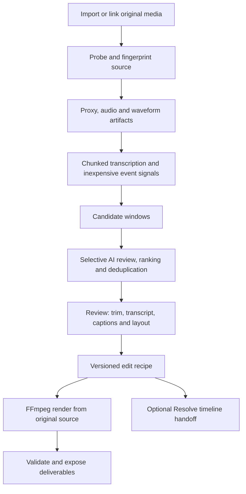

# ClipOS review and decision log

Reviewed on 16 November 2026, Asia/Kolkata. Requested by the user: review the existing application, recommend improvements for long gaming streams, editing, video quality, throughput, AI, MCP, and DaVinci Resolve; document decisions in the Obsidian vault.

**Recommendation:** retain React, FastAPI, Redis/RQ, and FFmpeg. Evolve ClipOS into a local-first assistant that discovers moments, prepares editable clip recipes, offers fast review, and renders approved clips from original media. Use Resolve as an optional finishing destination. Add MCP as an interface to stable operations after the underlying pipeline works reliably.

This document separates observed facts from proposed changes. No pipeline refactor, model change, software installation, purchase, MCP connection, or deployment was performed. Existing edits in `captions.py`, `ffprobe.py`, and `llm_fallback.py` were preserved.

## Evidence and immediate problems

| Finding | Evidence | Consequence and recommendation |
| --- | --- | --- |
| Default FFmpeg and ffprobe are currently broken | Direct execution of `/opt/homebrew/bin/ffmpeg -version` and `/opt/homebrew/bin/ffprobe -version` fails: missing `libx265.216.dylib`. `/opt/homebrew/opt/ffmpeg-full/bin/{ffmpeg,ffprobe}` both run successfully. | First repair application binary discovery. Select and validate one FFmpeg/ffprobe pair centrally, using configured paths and stable Homebrew `opt` paths. Check required filters/encoders at startup. A global Homebrew repair is separate work. |
| Binary selection is inconsistent | [captions.py](/Users/yoboxo/Developer/ClipOS/clipos-backend/app/core/captions.py:23) and [ffprobe.py](/Users/yoboxo/Developer/ClipOS/clipos-backend/app/core/ffprobe.py:7) use version-specific paths; transcription, cutting and reframing invoke plain `ffmpeg`. `FFMPEG_FULL_PATH` is interpreted as a file in captions and a directory in probing. | A captions-only fix cannot repair the whole pipeline. Resolve both binaries once and use them in every module. |
| A captioned deliverable receives three lossy video encodes | [clip_cutter.py](/Users/yoboxo/Developer/ClipOS/clipos-backend/app/core/clip_cutter.py:58), [reframe.py](/Users/yoboxo/Developer/ClipOS/clipos-backend/app/core/reframe.py:266), [captions.py](/Users/yoboxo/Developer/ClipOS/clipos-backend/app/core/captions.py:194). All use libx264. | Avoid full-quality intermediate clips. Analyze proxies; combine trim, crop/composition, scaling, subtitle rendering and optional audio processing in one final video encode from the original. Separate preview encodes are acceptable. |
| All work occupies one queue job | [queue.py](/Users/yoboxo/Developer/ClipOS/clipos-backend/app/core/queue.py:45) sets a fixed 30-minute timeout. [pipeline.py](/Users/yoboxo/Developer/ClipOS/clipos-backend/app/core/pipeline.py:58) executes every stage and clip in sequence. | Multi-hour streams need checkpoints, duration-aware task sizing, cancellation, stage retries and bounded concurrency. Do not simply raise the timeout indefinitely. |
| Failures do not propagate to RQ | Pipeline exception handlers mark the database failed and return normally. | RQ can consider execution successful although ClipOS failed. Persist the failure and propagate an exception to the queue; reconcile timeouts, killed workers and stale heartbeats. |
| Partial cut failures are mishandled | `cut_clips` returns successful cuts, but pipeline ignores that result and reloads every candidate ID from highlights. | A failed cut can be attempted during reframing and stop other clips. Track success/failure per clip and continue independent candidates. |
| Duplicate starts and queue status are fragile | [jobs.py](/Users/yoboxo/Developer/ClipOS/clipos-backend/app/routers/jobs.py:110) checks `ingested` but does not atomically claim work or persist the returned RQ ID. Status polling scans queue registries. | Add an atomic run claim, run ID and persisted task IDs. Read task status directly; distinguish queued, executing, retrying, failed and completed. |
| Highlight detection only sees speech | [highlights.py](/Users/yoboxo/Developer/ClipOS/clipos-backend/app/core/highlights.py:116) sends the whole transcript in one request and asks for 3–6 clips total. | Long streams can exceed practical context/latency limits and visual events can be missed. Analyze overlapping windows, merge duplicates, and use audio/visual signals as candidate inputs. Make output count or selection budget configurable. |
| Reframing is oriented toward talking heads | [reframe.py](/Users/yoboxo/Developer/ClipOS/clipos-backend/app/core/reframe.py:22) decodes frames, detects every fifth frame, picks the largest Haar-cascade face, carries its position forward and smooths it. | Gameplay faces, a small facecam or scene changes can give unsuitable crops. Prefer user-selected facecam/gameplay regions, layout templates, confidence thresholds and manual correction. |
| Captions display one isolated word at a time | [captions.py](/Users/yoboxo/Developer/ClipOS/clipos-backend/app/core/captions.py:173) generates one Dialogue event per word, all highlighted. | Add phrase grouping, punctuation-aware breaks, readable line limits, active-word emphasis, editable text, brand styles and platform-safe placement. |
| The frontend offers review/download rather than editing | [ClipDetailPage.tsx](/Users/yoboxo/Developer/ClipOS/clipos-frontend/src/pages/ClipDetailPage.tsx:61) has original/vertical playback and a burn button, but no trim, transcript, crop or caption editor. Burn completion is held only in component state. | Build a focused clip-review editor with durable export states; derive available variants from backend artifacts. Preview the captioned result and persist render status across refreshes. |
| Transcription is CPU-only | [transcribe.py](/Users/yoboxo/Developer/ClipOS/clipos-backend/app/core/transcribe.py:16) hardcodes faster-whisper base/CPU/int8 with word timestamps and no explicit VAD settings. | Evaluate a hardware-appropriate ASR adapter, VAD and overlapping chunks. Preserve the canonical word schema and original media time offsets. |

Local hardware observed: Apple M4, 16 GB unified memory. The working FFmpeg build exposes `h264_videotoolbox`, `hevc_videotoolbox`, `libx264`, `ass`, `subtitles`, and `loudnorm`. Encoder/filter presence was verified; hardware encoding performance and output quality were not benchmarked.

## Proposed architecture

Use one application codebase with independently runnable worker processes. Keep Redis/RQ; create bounded queues for ingest/analysis/render as needed. The database should track assets, pipeline runs, stage attempts, clips, edit revisions and render outputs. Introduce these additively with migrations; retain existing job IDs and transcript/highlight fields. Store large artifacts in files, not Redis. Use atomic artifact writes and validate outputs before marking stages complete.

The edit recipe should reference original source intervals, layout regions, crop keyframes, caption corrections/styles, audio settings and export preset. Give recipes a schema version and revision ID. Cache keys should include the source fingerprint plus the relevant model, prompt, algorithm and settings versions. Caption changes should invalidate caption preview/final render, without retranscribing. A crop change should invalidate composition/render, without rerunning highlight discovery. Retry operations must not overwrite approved edits.

Keep SQLite for the initial single-machine workflow, with short transactions and controlled writers. Move to PostgreSQL when concurrent writers, multiple hosts or shared operation make that necessary. Object storage and remote GPU workers are later options justified by measurements. A local folder/library import avoids uploading already-local multi-gigabyte recordings. Remote imports should enqueue downloads rather than hold an HTTP request open. Consider resumable transfers when remote uploads become part of the workflow.

## Editing and output quality

The first editor should support trim handles, waveform/transcript navigation, caption correction, draggable/resizable source regions, layout presets, undo and preview/export. Prioritize keyboard shortcuts, accept/reject/extend actions, and quickly reviewing many candidates. Show the moment-selection reason and uncertainty rather than implying a model score is a measured probability of virality. A full professional timeline can remain in Resolve.

For gaming streams, provide three initial layouts: gameplay plus a dedicated facecam panel; full gameplay fitted into the canvas with a designed background; and a manually chosen action crop. Protect HUD, minimap, subtitles and important action regions. A 1920×1080 image cropped to 9:16 retains only roughly 608×1080 pixels before upscaling; a 1080×1920 output does not recreate the discarded detail. Choose composition before applying sharpening or upscaling. Reset tracking at scene boundaries; use actual presentation timestamps for variable-frame-rate sources rather than only frame-count/rounded-fps estimates.

Retain the best available original recording and avoid downloading/re-encoding it repeatedly. Support OBS-style MKV/multiple audio tracks through probing and optional remuxing, with original files preserved. Record microphone and game audio separately where possible; retain separate facecam/gameplay sources when available. Select the microphone track for ASR and allow independent mixes for exports. Apply restrained normalization/limiting and optional ducking, preserving game effects and speech. Avoid aggressive denoising of already compressed footage.

Use explicit export presets with dimensions, rational frame rate/timebase, pixel format, codec, bitrate/quality controls and color handling. Preserve genuine 60 fps gameplay where appropriate. Use H.264/AAC MP4 and browser-friendly playback as an initial interoperability target, then validate actual destination needs. Compare libx264 quality settings against VideoToolbox at comparable visual quality; do not apply CRF settings to hardware encoders as if they were equivalent. CPU subtitle/composition filters can remain a bottleneck even with hardware encoding. HDR inputs require deliberate SDR tone mapping for SDR exports; merely changing color tags is insufficient. FFmpeg provides composition/subtitle filters and loudness normalization: [filter documentation](https://ffmpeg.org/ffmpeg-filters.html).

Validate final dimensions, duration, audio presence, A/V synchronization, caption bounds, clipping and representative playback. Persist final source timestamps after clamping so captions and cuts use the same intervals. Use temporary outputs and rename only after successful validation.

## AI strategy for long gaming streams

Use inexpensive signals to propose windows: speech/transcript content, laughter/shouts/audio changes, scene boundaries, optional available chat bursts, and optional manual hotkey markers. These signals are noisy; action volume alone does not establish a good clip. Keep silent gameplay highlights eligible even when no speech is present. An empty transcript should not necessarily fail the whole project.

Start with overlapping analysis windows, for example 5–10 minutes with contextual overlap, and tune on actual streams. Preserve absolute timestamps, merge repeated events across boundaries, and retain setup and payoff. Ask a language model to identify narrative quality using transcript and signal metadata. Send short candidate excerpts or sampled frames to a vision-capable model only where needed. Sparse frames help with composition but can miss fast action; temporal context matters. Score and filter candidates before expensive full-resolution render work.

Require structured outputs and validate finite timestamps, bounds, duration, overlap, valid IDs and score ranges. Treat schema/semantic validation failures as retry/fallback conditions; the current provider chain only falls back when the call/content extraction itself raises, while JSON parsing happens later. Put models in configuration and record provider, model, prompt version, latency and cost. Current highlight-specific provider tiers and shared defaults differ; documentation also names older choices. Choose models with a small representative evaluation set rather than by model size or a nominal free tier. Use request deadlines and retry/backoff policies that distinguish rate limits, transient errors and permanent errors. Remove even partial API key logging from the NVIDIA client.

For this M4 machine, benchmark MLX Whisper with word timestamps against the current CPU baseline. Keep model size selectable; better transcription can cost more compute. MLX supports the required word timestamp interface: [MLX Whisper documentation](https://github.com/ml-explore/mlx-examples/tree/main/whisper). For a future NVIDIA host, faster-whisper offers batching and CUDA execution: [maintainer documentation](https://github.com/SYSTRAN/faster-whisper). Preserve silence offsets when using VAD and deduplicate overlapping chunk words. Test game names, overlapping speech, accents and mixed-language commentary actually present in the user's recordings. Start with one ASR worker and one render worker on 16 GB; tune concurrency against peak memory, interactive responsiveness and thermal behavior.

Current RQ is pinned and locally installed at 2.0.0. Evaluate a tested upgrade to use `SpawnWorker` (introduced in 2.2.0) for macOS rather than relying on disabling Objective-C fork safety. This is still RQ, not a queue-library migration. A long-lived inference process is a separate option for keeping models loaded; merely selecting a spawning worker does not guarantee model reuse across jobs. See [RQ worker documentation](https://python-rq.org/docs/workers/).

## DaVinci Resolve and MCP

Recommend Resolve as an optional destination for stronger pacing, audio mixing, color and bespoke effects after ClipOS narrows a stream to good candidates. Start by exporting selected source ranges, source media references, markers and SRT subtitles with a tested timeline interchange format such as OTIO. Validate exact trim points, frame rates, audio mapping and relinking against the installed Resolve version. Animated ASS styles, arbitrary layout transforms and effects should not be assumed to round-trip; some require explicit recreation through an adapter or a flattened render. Blackmagic documents OTIO interchange in its [new-features guide](https://documents.blackmagicdesign.com/SupportNotes/DaVinci_Resolve_18.5_New_Features_Guide.pdf).

As of this review, Blackmagic's Resolve 21.1 announcement documents native AI-assistant integration for project analysis, media organization, highlight edits and batch rendering. Its current feature matrix lists AI Assistants requiring an MCP-compatible assistant, and scripting, as Studio features. Prefer evaluating this official integration before choosing a community bridge. Check the installed edition/version and supported operations with a small project before paying for Studio solely for automation. Sources: [official release](https://www.blackmagicdesign.com/media/partial/release/20260908-03), [official feature matrix](https://documents.blackmagicdesign.com/SupportNotes/DaVinci_Resolve_Studio_21_Features.pdf). Resolve Free is a reasonable manual-finishing trial; advanced automation needs the edition check above.

For ClipOS itself, use normal Python functions/APIs and queue workers for the production media pipeline. MCP standardizes AI access to tools/data; it does not accelerate encoding or supply editing quality by itself. A later thin MCP interface could expose `search_moments`, `create_clip_draft`, `update_clip_edit`, `request_render`, and `get_render_status`. Long operations should return task IDs. Validate edit recipes server-side; give tools project-scoped media access. The same versioned recipe should drive UI edits, AI-requested edits and renders. See [MCP introduction](https://modelcontextprotocol.io/docs/getting-started/intro).

The Obsidian log is plain Markdown in a local vault, so an Obsidian MCP connection is unnecessary for this documentation request. No connector was installed or connected during review.

## Recommended implementation order and measurement

1. **Restore reliable operation:** central FFmpeg pair selection and startup checks; correct task failure reporting; persist queue IDs; prevent duplicate starts; retain successful clips when a peer fails; add real stage/clip progress and retry/resume.
2. **Improve the core experience:** versioned edit recipes, source fingerprints, proxies, early candidate ranking, gameplay layout presets, editable phrase captions and one-pass final rendering. This is the first useful vertical slice.
3. **Handle long streams:** overlapping transcription/analysis chunks, bounded workers, VAD, multimodal candidate review, artifact caching, incremental candidate availability and cancellable exports.
4. **Add finishing/integrations:** tested Resolve handoff; evaluate native Resolve MCP if desired; add a thin ClipOS MCP surface after its API is stable. Add remote GPUs or distributed storage only if measurements justify them.

Before promising a speedup, measure a representative 10-minute recording and a 2–4-hour gaming stream. Include fast action, facecam, quiet gameplay, mixed speech, and the actual source frame rate/resolution. Record stage wall time, real-time factor (processing time/source duration), cold/warm model startup, CPU/memory, model/API costs, time to first useful preview, final render fps, and disk use. Assess accepted clips per reviewed candidate, missed manually marked highlights, caption accuracy and crop failures. Compare old/new outputs visually at comparable quality, not just equal bitrate. Include cancellation, duplicate-run, worker-crash, malformed-model-output and resume scenarios in integration verification. Existing mocked tests do not establish real media quality or throughput.

## Decision register

Append future entries with date, status, decision, rationale, alternatives, affected files and validation. Change a recommendation to accepted only when selected by the user or implemented within authorized scope. Implementation outcomes and reversals should be appended rather than silently rewriting history.

| ID | Status on 2026-11-16 | Decision and rationale |
| --- | --- | --- |
| DOC-001 | Implemented | Use `/Users/yoboxo/Developer/Developer/ChatGPT Data/ClipOS/` for the requested Obsidian documentation, with this report mirrored in the repository for reviewability. |
| DOC-002 | Implemented | Make this turn an assessment and documentation change; preserve existing application edits and distinguish proposed architecture from implemented behavior. |
| ARCH-001 | Proposed | Retain the main stack and evolve to staged, resumable execution rather than a ground-up rewrite. |
| MEDIA-001 | Proposed | Centralize binary configuration first because the current default binaries fail at process startup. |
| MEDIA-002 | Proposed | Preserve originals, analyze proxies and perform one final video encode for each approved recipe. |
| EDIT-001 | Proposed | Build a focused review editor and game-aware composition presets before a full timeline editor. |
| AI-001 | Proposed | Use multimodal candidate selection with bounded analysis windows and strict validation; rank before rendering. |
| PERF-001 | Proposed | Benchmark MLX ASR and VideoToolbox on the existing M4/16 GB machine before recommending new hardware or making speed claims. |
| DATA-001 | Proposed | Add run/clip/edit/render records and migrations without renaming canonical schemas; retain SQLite initially. |
| INTEGRATION-001 | Proposed | Use Resolve for optional finishing and evaluate its official Studio MCP integration before community bridges. |
| MCP-001 | Proposed | Add MCP as a thin optional interface over reliable ClipOS operations; keep normal APIs/queues responsible for execution. |

## Validation performed for this review

Read repository conventions, pipeline, queue, workers, models, ingest, ASR, highlight/scoring/provider logic, cutting, reframing, captions, key frontend pages and relevant tests. Checked the local hardware class and memory, installed RQ/faster-whisper versions, default and alternate FFmpeg/ffprobe execution, and alternate build encoder/filter availability. Checked current primary-source documentation for the proposed external integrations. No full pipeline or speed/quality benchmark was run, no API keys were read from `.env`, and no application source files were changed.

## Follow-up — Implementation planning, 2026-11-16

The user requested a plan for edits. Created [[2026-11-16-implementation-plan]] with seven ordered phases, affected modules, completion checks and a first delivery milestone covering reliability, edit recipes/rendering and the focused editor. PLAN-001 records the documentation work; PLAN-002 through PLAN-005 remain proposed in that plan. No application edits, purchases or connections were started. This follow-up preserves all earlier findings and decision statuses.

## Follow-up — User-confirmed outcome, 2026-11-16

The user clarified the governing goal: a 3-hour gaming stream should become roughly 10 strong, nicely edited, upload-ready clips in about 20 minutes. Automatic selection, editing, rendering and validation are the normal path; manual review/editing is an optional override. This supersedes the review's earlier editor-first delivery emphasis and PLAN-002's first-release proposal, while preserving their history.

GOAL-001 records the accepted user requirement in [[2026-11-16-implementation-plan]]. That plan now prioritizes an automatic end-to-end prototype, consistent output quality and then measured latency against representative full streams. It includes a provisional timing budget and separates network transfer from compute measurements while conservatively accounting for both in the total. Required hardware and actual feasibility remain unverified. No application changes were performed for this clarification.

## Implementation decision — Phase 1, 2026-11-16

**Status: implemented (fixture/integration validated); representative-stream baseline pending.**
The user authorized phase-by-phase implementation and requested a stop after each
phase. Phase 1 is implemented; phase 2 has not started. Existing captions/probing
intent was consolidated into the shared resolver; the user's LLM fallback edits
were preserved. The automatic end-to-end goal remains the governing requirement.

| ID | Status | Decision and rationale |
| --- | --- | --- |
| REL-001 | Implemented | Use one capability-checked FFmpeg/ffprobe pair for every media operation and yt-dlp merging. Prefer the working stable Homebrew ffmpeg-full opt path; support explicit executable paths and both historical FFMPEG_FULL_PATH forms. No Homebrew packages changed. |
| REL-002 | Implemented | Add versioned, transactional migrations and pipeline_runs/stage_attempts/clip_states. A nullable unique active_key atomically permits one active run per job. Persist each task ID before enqueue and fence ambiguous late delivery after enqueue failure. Canonical schemas remain compatible. |
| REL-003 | Implemented | Queue individual analysis/clip work units, record timings/heartbeats and bounded deadlines, reuse validated input/output checkpoints, and reconcile dispatch gaps/lost workers. Retry directly identifiable transient network/429/5xx failures at most three times per unit/run. Preserve independent clips when a peer fails, while raising failed attempts to RQ. |
| REL-004 | Implemented | Add safe-boundary cancellation, idempotent run/resume APIs, detailed progress and durable output-variant discovery. Prevent manual artifact mutations during active automatic execution. Partial batches retain usable clips and map to failed in the legacy job while exposing completed_with_errors in run state. |
| REL-005 | Implemented | Include caption burn-in in automatic processing now, aligning reliability work with the accepted no-required-review target. Continue using the existing multi-pass renderer until phase 2 introduces recipes and one-pass rendering. Promote outputs atomically after validation. |
| REL-006 | Implemented | Isolate tests from the working library/provider APIs/shared Redis. Use a temporary private Redis Unix socket for integration checks and a copied SQLite library for migration verification. No model inference, paid API calls or destructive library operations were used. |
| REL-007 | Accepted, pending measurement | Treat phase 1 as the reliable execution/instrumentation foundation. Do not claim M0's representative baseline, M1's three-hour automatic result or the 20-minute target is achieved from synthetic fixtures. |

**Affected files:** backend config/main/worker, models/job.py and new
models/execution.py, app/migrations/, core/media.py/artifacts.py/execution.py,
core/pipeline.py/queue.py, FFmpeg/ffprobe callers, atomic transcription/highlight/
scoring writes, jobs API and manual-stage guards. Frontend API types, progress/status
rail, job/gallery navigation, clip player/download state, focused tests, backend
README and project SKILL.md were updated. Full details remain reviewable in the
working-tree diff; no commit or production service restart was performed.

**Validation:** 91 backend tests passed in an isolated temporary application copy,
including real FFmpeg extraction/probe/cut/reframe/ASS burn, 1080×1920 output,
audio presence/duration agreement, concurrent starts, duplicate delivery, bounded
transient retries, enqueue ambiguity, cancellation, invalid checkpoints, real RQ
failure and actual workhorse-process termination followed by checkpoint resume.
Seven frontend tests passed; TypeScript/Vite production build and git diff whitespace
checks passed. The build emits nonfatal CSS directive warnings. The real forked
worker test emits Python's multithreaded-fork deprecation warning; the planned
RQ/macOS worker evaluation remains phase 6.

Migrated a backed-up copy of the default local SQLite library twice: all 13 jobs
and their existing field values were preserved. The original library was not
migrated or modified by verification. Temporary backup:
`/var/folders/rp/qnp030cn1nzflxjc7gw9xmnr0000gp/T/clipos-library-migration-mmg0xw1b/library-backup.db`.
Repeatable synthetic legacy-schema migration is also covered by tests.

**Limits / next phase:** no representative gaming-stream quality or throughput
benchmark was run. ASR remains a single bounded task until phase 4. Provider wrappers
that collapse errors into RuntimeError remain manually resumable; provider error
policy belongs to phase 5. Source identity currently uses immutable job-media
size/mtime; full versioned fingerprints/caches belong to phase 4. Existing face
tracking and word-at-a-time caption styling remain until their planned changes.
Next authorized work package to discuss is phase 2: edit recipes, proxies and
one-pass final rendering. Work stops here as requested.

Implementation consulted the installed RQ 2.0.0 API and official
[RQ failure/retry documentation](https://python-rq.org/docs/exceptions/); the queue
library and dependency versions were retained.

## Implementation decision — Phase 2, 2026-11-16

**Status: implemented (short-media, API, queue and regression validated).** The user
requested the next phase after reviewing Phase 1. Phase 2 is complete at its stated
fixture acceptance checks; work stops here. Phase 4 has not started. The revised
automatic delivery order remains 1 → 2 → 4 → 5 → 6; phase 3 is optional correction UI.

| ID | Status | Decision and rationale |
| --- | --- | --- |
| RECIPE-001 | Implemented | Add strict schema-version-1 edit recipes and immutable edit revisions, independent of AI highlight metadata. Bind to the job/source SHA-256 fingerprint, absolute source intervals, normalized displayed-source regions, output-local caption/keyframe times, selected audio indexes/gains and explicit export settings. Atomic expected-revision saves reject stale requests with HTTP 409. Automatic retries preserve saved edits. |
| MEDIA-003 | Implemented | Register source fingerprints and expanded stream/rational-frame-rate/sample-aspect/color/audio metadata. Reuse versioned proxy, thumbnail and waveform artifacts after signature checks; preserve original media. Cache a registered fingerprint while original size/mtime remain unchanged. |
| RENDER-001 | Implemented; realizes MEDIA-002 for final renders | Replace the automatic intermediate cut/reframe/burn dependencies with per-clip recipe and direct-source render units. One final video encode combines interval trims/concatenation, composition/scaling, crop keyframes, ASS and audio mixing. Keep legacy files and handlers readable/runnable. |
| LAYOUT-001 | Implemented | Provide full-gameplay fit on a solid background, gameplay plus a supplied facecam region, and positioned/animated crop. Default to full-gameplay fit so an unverified facecam/action crop does not discard the HUD. Automatic facecam discovery and representative gaming composition quality are not established in this phase. |
| RENDER-002 | Implemented | Pin queued preview/final work to immutable revision IDs, deduplicate active/valid completed work, retain durable IDs/errors/heartbeats, reconcile lost tasks and fence ambiguous enqueue delivery. Render to unique revision-associated paths and promote verified files atomically; keep old renders and legacy variants. |
| EXPORT-001 | Implemented, limited preset | Use 1080×1920 final / 360×640 preview, H.264/AAC MP4, yuv420p, square pixels and rational 1–60 fps. Mix explicitly selected audio tracks with gain/limiting, preserve delayed-audio timing, and provide silent AAC when no tracks are selected. Reject HDR/rotated final inputs pending the deliberate conversion work planned for phase 6. |
| API-001 | Implemented | Expose edit/save, assets and queued preview/final/history APIs with durable availability and current-revision flags. Gallery/player/download views use current final renders; legacy variants remain accessible. Serve raw/clips configured roots independently, preserving canonical media URLs. Full editing controls remain optional phase 3. |

**Affected files:** new backend `models/edit.py`, `core/recipes.py`, `core/assets.py`,
`core/renderer.py`, `core/renders.py`, `routers/edits.py` and `tests/test_edits.py`;
migration 3; expanded ffprobe metadata; pipeline/queue/reconciliation/main/jobs;
isolated test fixtures and Phase 1 queued-unit regression tests. Frontend API
schemas, clip/gallery/player/status display and recovery tests; SKILL.md and backend
README. No new dependencies, global package changes, commit, or deliberate live
service restart was performed.

**Validation:** **111 backend tests passed** (26.71 seconds for the final fixture
suite), **8 frontend tests passed**, TypeScript/Vite production build and diff
whitespace checks passed. New real-media checks cover all three final layouts,
preview rendering, rational 30000/1001 frame rate, multiple intervals/tracks, silent
source audio, delayed-source audio, source-file preservation, subtitle text/control
escaping, and visible trim/caption timing. Frame samples verify reordered blue/red
source ranges and caption appearance only during the saved local interval. Visually
inspected a three-layout fixture contact sheet. API checks include save/reload,
concurrent revision conflicts, stale render revision flags, immutable output
history, enqueue/lost-worker recovery, byte-range MP4 downloads and navigation
thumbnail URLs. A private Redis/RQ worker completed a real preview render. Automatic
pipeline and caption-only/crop-only resume tests verify that ASR/highlight/scoring
calls are not repeated and no high-quality intermediate clip is required.

Migration 3 ran twice against a backed-up copy of the default local library,
preserving all **13** original jobs and their existing field values. The working
library was not migrated by verification. Temporary backup:
`/var/folders/rp/qnp030cn1nzflxjc7gw9xmnr0000gp/T/clipos-phase2-migration-fo5wec7x/library-backup.db`.
Existing nonfatal CSS directive build warnings and the fork-worker test warning
remain; the RQ/macOS worker evaluation stays in phase 6.

**Limits / milestone accounting:** no full gaming-stream inference or quality/
latency benchmark was run, so M1 and the approximately 20-minute target remain
unverified. Proxy generation and ASR are still bounded whole-source units until
phase 4 adds resumable chunks; initial asset preparation adds real work that must
be included in end-to-end timing. Preview and final share recipe semantics but
are separately encoded from the original; the source proxy is a reusable navigation
asset, not a required final intermediate. Defaults do not infer a facecam region or
perform phrase-caption editing. HDR/rotation conversion, richer selection/pacing
and the optional full editor remain later packages. Next is phase 4: multi-hour
imports, audio selection, overlapping chunk analysis and resumable caches.

Implementation checked the official [FFmpeg filter documentation](https://ffmpeg.org/ffmpeg-filters.html)
and [FFmpeg command/stream documentation](https://ffmpeg.org/ffmpeg.html), then
validated the installed binary's actual output with fixtures rather than inferring
media correctness from mocked command calls.
